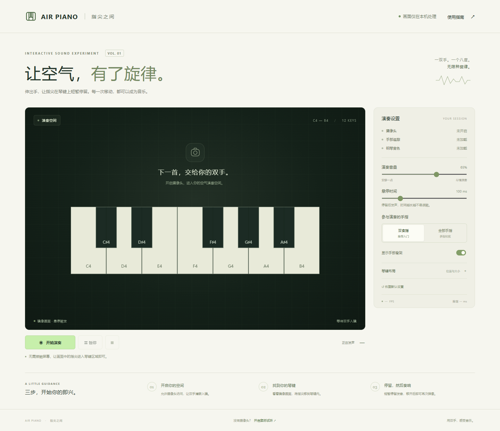

# Air Piano 指尖之间

基于封闭图形与 MediaPipe 手部追踪的电脑虚拟钢琴。将双手放入摄像头画面，让指尖标记进入琴键并短暂停留，即可发音。无需触摸屏幕。



## 在电脑上运行

建议使用 Node.js 22.12 及以上版本，以及桌面 Chrome 或 Edge。首次安装依赖需要联网。

在 PowerShell 中执行：

```powershell
Set-Location 'your project location'
npm ci
npm run dev
```

打开终端显示的本地地址，默认是 http://127.0.0.1:5173 。点击“开始演奏”，允许摄像头访问，等待追踪与音色准备完成。

模型、WASM 和钢琴采样已包含在 `public/assets` 中。正常运行不需要访问外部 CDN，也不会上传摄像头画面。若资源缺失，执行 `npm run assets` 重新下载；资源下载脚本保留已有文件。

## 怎么弹奏

1. 固定摄像头，使用均匀光线，让手掌和指尖完整入镜。
2. 默认只使用左右食指。看着镜像画面，让指尖进入琴键区域并停留100毫秒。
3. 指尖停留期间只起音一次。移出后再进入即可重复弹奏。
4. 切换“全部手指”可演奏和弦；使用“琴键布局”调整位置和大小。琴键始终位于实际视频内容区域内。
5. “暂停”释放音符并保留摄像头；“结束”关闭摄像头、识别线程和音频上下文。切换后台或窗口失焦会暂停演奏。

没有摄像头时，点击底部“开启鼠标试听”，按住琴键演奏，松开释放。也可用 Tab 聚焦音符按钮，再按空格或回车演奏。

音量、悬停时间、手指模式、骨架和布局设置自动保存在本地浏览器中，可恢复默认值。

## 曲库与逐音练习

1. 点击“曲目练习”，从《小星星》《欢乐颂》《两只老虎》和原创《指尖小阶梯》中选曲。曲目均为教学单旋律版本，卡片说明音域、改编方式和来源。
2. 可先“试听整首”，自动播放会同步指示琴键；点击“停止试听”随时结束。试听不参与练习判定。
3. 点击“开始练习”，跟随琴键上的蓝色边框与▼箭头弹奏。已开启摄像头时可用手势；也可直接开始，以鼠标或Tab聚焦后的空格/回车练习。
4. 弹对后进入下一音，但必须先释放所有已按下琴键。重复音也需要移开再弹。弹错正常发声、短暂橙色提示，进度保持不变。
5. “暂停练习”和演奏区“暂停”行为一致：释放声音、暂停识别并保留进度和摄像头连接。任一“继续”按钮均可恢复课程和现有摄像头，无需重新申请。切换后台、窗口失焦、打开指南也会暂停；“结束”才会释放摄像头，重新启动时是否弹出授权由浏览器权限设置决定。
6. 完成后显示音符数、错误次数、首次命中率和有效用时。首次命中率为第一次尝试就弹对的步骤数除以总音符数，暂停时间不计入用时。

键盘现为C4～C5共13键（8白键、5黑键）。练习等待用户弹对，不评价节奏、休止或按住时长；试听按曲谱时值执行。完成记录仅保存在本浏览器，不上传。

### 分段、循环和练习记录

- 曲库支持按名称、难度和音域筛选。开始练习或试听后会折叠曲库并收起顶部介绍，突出当前目标和琴键；点击“返回曲库”结束当前练习并重新选曲。
- 展开“范围与试听速度”，输入起始、结束音符编号，点击“应用范围”。编号不计休止；改变范围会重置当前进度。试听也使用这一范围，支持0.5、0.75、1和1.25倍速度，变速不改变音高。
- 勾选“循环练习”，完成并释放全部琴键后自动重来。每完成一轮单独记录结果；暂停、切歌或结束都会停止自动循环，继续/重新开始后按开关状态恢复。
- 完成后若有错误，可点击“练习易错片段”：提取首次至末次错误之间的范围，并尽可能保留前后各一个音作为上下文。
- 展开“本地练习记录”查看结果。最多保存50次，列表显示最近10次；最近/最佳命中率只比较相同歌曲和范围。清除记录不影响演奏设置。

### 指尖进入琴键但没有响

琴键下方会显示具体状态：正在确认、已触发需要移开、手部未入镜、音色未就绪、静音、试听或暂停。指尖圆环仅显示有效识别支持的进度，短暂漏检会冻结进度，不能靠等待自动填满。

悬停容错按有效识别间隔调整，候选状态容忍160～320毫秒，已起音释放等待200～320毫秒；检测到漏检时不累计该段时间，间隔较长时单次最多累计120毫秒，过期后必须重新确认。超过200毫秒的旧画面仍会被跳过，避免迟到的位置触发声音。

“检查琴键可达性”要求已开启摄像头，依次用指尖触发C4、G4、C5。够不到时可调整琴键布局，不会自动扩大键盘或替用户按键。检查中鼠标/辅助键盘不能代替手势通过；可以随时停止，再继续原课程。

“触发诊断”默认收起，展开后显示识别间隔、推理时间、旧结果数、悬停进度与最近原因；不保存画面和诊断历史。

新增曲目在 `src/songs.ts` 中登记，使用MIDI音高与拍数；`null`表示休止。音域必须位于60～72，超出范围会阻止启动，不会折回八度。实现细节见[开发说明](docs/开发说明.md)。

## 构建与部署

```powershell
npm run build
npm run preview
```

`dist/` 是可部署的完整静态站点。生产环境使用 HTTPS，并部署到域名根路径；`localhost` 或 `127.0.0.1` 可用于本地摄像头访问。不要直接双击 `index.html`，也不要使用普通 HTTP 局域网地址访问摄像头。

静态服务器应将 JavaScript 作为脚本类型提供，WASM 使用 `application/wasm`。如需子路径部署，需要同时调整 Vite base 与 Worker 中的资源路径。

## 验证

```powershell
npm test
npm run test:e2e
```

单元测试覆盖几何命中、镜像映射、悬停与重弹、丢手释放、同键多指占用、手部关联、逐音判定、曲谱校验和试听调度。浏览器测试使用本机 Edge，覆盖真实模型与摄像头帧推理、手部图片到发音的闭环、鼠标及键盘、整曲练习、试听隔离、暂停/切歌、异常恢复和窄屏布局。

浏览器测试首次使用时会将 Google 官方手部测试图片下载到 `work/thumb_up.jpg`，需要联网。后续可使用缓存。可设置 `PLAYWRIGHT_CHROMIUM_EXECUTABLE_PATH` 指定浏览器路径；非 Windows 环境应先运行 `npx playwright install chromium`，或通过该环境变量指定已安装的浏览器。测试使用合成摄像头，不会打开实体摄像头。

`npm run test:e2e` 会自动启动并关闭自己创建的本地测试服务，也可复用已有的4173端口服务。设置 `TEST_BASE_URL` 时，应先启动该地址对应的服务；测试结束后保留用户自己启动的服务。

15分钟连续回放验证：

```powershell
# 先运行一次浏览器测试，准备手部测试图片。
npm run build
npm run preview -- --port 4174 --strictPort
# 在另一终端中执行，使用稳定的生产构建，避免开发热更新打断测试。
$env:TEST_BASE_URL = "http://127.0.0.1:4174"
npm run test:soak
```

结果输出至 `work/soak-result.json`。该检查使用手部图片持续回放，不能替代真实摄像头、四指和弦以及端到端音频延迟的人工验收。

## 常见问题

- 摄像头拒绝授权：在浏览器地址栏的网站权限中允许摄像头，然后重试。
- 摄像头无法读取：检查是否被其他应用占用，或设备是否连接。
- 模型初始化失败：使用支持 WebGL 与 OffscreenCanvas 的桌面浏览器，检查本地资源是否完整。识别线程先尝试 GPU，失败后尝试 CPU。
- 没有声音：确认音量、系统输出设备，点击开始或鼠标试听以启用浏览器音频。
- 指尖不稳定：减少遮挡，改善光照，先使用双食指并适当增加悬停时间。
- 指尖没有触发：确认标记位于可见琴键内，并保持至少所设悬停时间。快速扫过不会发音。

## 项目文档

- [开发任务书](docs/开发任务书.md)
- [开发说明](docs/开发说明.md)
- [验收记录](docs/验收记录.md)
- [第三方资源与许可](docs/资源说明.md)

项目源码采用根目录 MIT 许可证。第三方模型、运行库和钢琴采样分别适用其许可证；钢琴采样为 Alexander Holm 的 Salamander Grand Piano，CC BY 3.0，经 Tone.js Audio 分发。
