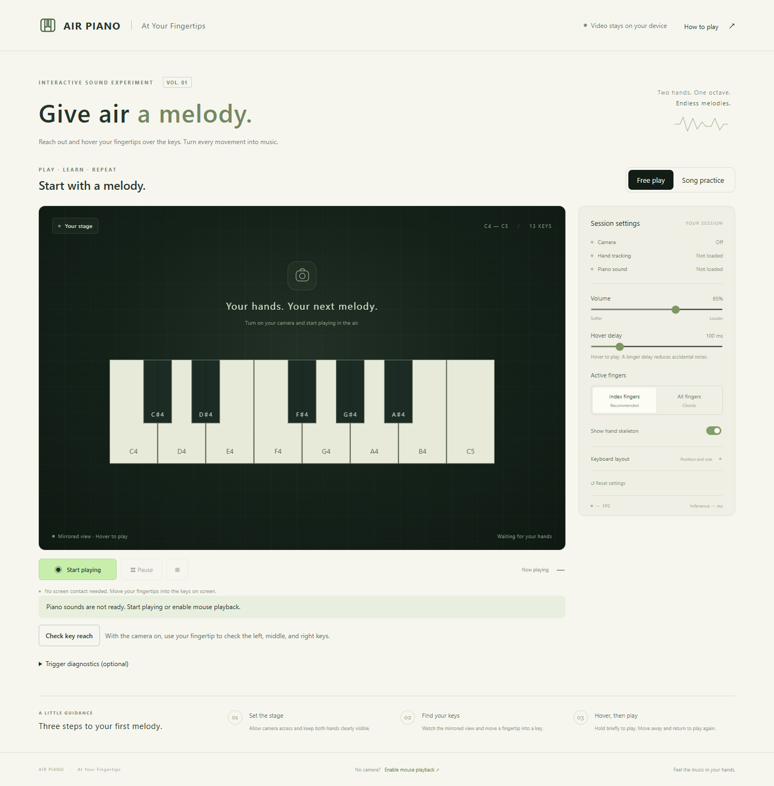

# Air Piano - At Your Fingertips (English Version)

A desktop virtual piano using closed key shapes and MediaPipe hand tracking. Move a fingertip marker inside a key and hover briefly to play. No screen contact is required.



## Run locally

Use Node.js 22.12 or newer with desktop Chrome or Edge. Installing dependencies for the first time requires internet access.

On Windows, double-click `start.cmd` to start the app and open your browser. It prefers the project-local Node.js 22 runtime in `work/runtime`, when available, otherwise system Node.js. The local runtime is ignored by Git and is not included in a fresh clone.

From PowerShell in the project directory:

```powershell
# Optional: use the local runtime prepared on this computer.
$localNode = Get-ChildItem '.\work\runtime\node-v22.*-win-x64' -Directory -ErrorAction SilentlyContinue | Select-Object -First 1
if ($localNode) { $env:Path = "$($localNode.FullName);$env:Path" }
npm ci
npm run dev
```

Open the address printed in the terminal, normally http://127.0.0.1:5173. Click **Start playing**, allow camera access, and wait for tracking and audio to become ready.

Models, WASM, and piano samples are bundled in `public/assets`. Normal operation needs no external CDN and uploads no video. Run `npm run assets` if resources are missing; existing downloads are preserved. `.gitattributes` protects asset bytes from Git line-ending conversion.

## Playing

1. Keep the camera steady in even light, with palms and fingertips fully visible.
2. Index fingers are enabled by default. Watch the mirrored view and hover a fingertip inside a key for 100 ms.
3. Each entry produces one attack. Move away and return to repeat a note.
4. Choose **All fingers** for chords; use **Keyboard layout** to adjust size and position. Keys stay inside the actual video content.
5. **Pause** releases notes but keeps the camera connected. **End session** closes the camera, worker, and audio context. Backgrounding or losing focus pauses playback.

Without a camera, click **Enable mouse playback** at the bottom. Hold a key to play and release to stop. Alternatively, Tab to an accessible note button and press Space or Enter.

Volume, hover delay, finger mode, skeleton visibility, and layout are saved in this browser. **Reset settings** restores defaults.

## Songs and note practice

1. Choose **Song practice**, then _Twinkle, Twinkle, Little Star_, _Ode to Joy_, _Frère Jacques_, or the original _Fingertip Steps_. These are single-melody teaching arrangements; cards describe range, adaptations, and sources.
2. **Preview song** automatically plays with synchronized key highlights. **Stop preview** ends it at any time. Preview never counts as practice input.
3. Click **Start practice** and follow the blue outline and downward arrow. Use camera gestures, the mouse, or Tab-focused note buttons with Space/Enter.
4. Correct notes advance progress, but all held keys must be released before the next step. Repeated pitches also require release. Wrong notes sound and briefly show orange feedback without advancing.
5. **Pause practice** and stage **Pause** share behavior: release sound, pause inference, retain progress and the camera connection. Either Resume control reuses the session without another camera request. Backgrounding, blur, and opening help also pause. Only ending releases the camera; later permission prompts depend on browser settings.
6. Completion shows note count, mistakes, first-try accuracy, and active time. Accuracy counts steps correct on their first attempt divided by total notes. Paused time is excluded.

The keyboard covers C4-C5: eight white and five black keys. Practice waits for correct input and does not assess rhythm, rests, or hold duration. Preview follows score timing. Records stay in this browser and are not uploaded.

### Sections, loops, and history

- Filter songs by title, level, and range. Practice/preview collapses the library and introduction to emphasize the target and keys. **Back to library** ends the current practice for reselection.
- Expand **Range and preview speed**, enter first/last note numbers, and choose **Apply range**. Numbers exclude rests. Changing range resets progress. Preview uses the same range at 0.5x, 0.75x, 1x, or 1.25x without changing pitch.
- Enable looping to restart after completion and release of all notes. Each round saves separately. Pause, song changes, and end cancel automatic looping; resume/restart restores it according to the checkbox.
- After mistakes, **Practice tricky section** selects from first to last mistaken step with one neighboring note on each side where possible.
- **Practice history** stores up to 50 sessions and displays 10. Latest/best accuracy compares the same song and range only. Clearing history leaves settings intact.

### A fingertip enters a key but no sound plays

Feedback explains confirmation, an already triggered note, no hand detected, audio readiness, mute, preview, or pause. Fingertip rings reflect valid observations only. Missing detection freezes progress rather than allowing elapsed time to fill the ring.

Candidate grace adapts to cadence within 160-320 ms; active release waits 200-320 ms. Missing intervals do not accumulate time; a single update adds at most 120 ms. Expiration requires fresh confirmation. Results older than 200 ms are skipped.

**Check key reach** requires an active camera. Confirm C4, G4, and C5 with a fingertip in order. Adjust layout if needed. It does not expand keys automatically or press notes for you. Mouse and accessible keyboard cannot pass the check. Stop anytime and resume the lesson.

**Trigger diagnostics** shows cadence, inference time, stale-result count, hover progress, and recent reasons when expanded. It stores no video or diagnostic history.

Add scores in `src/songs.ts` using MIDI pitches and beats; `null` means rest. Pitches must be 60-72. Invalid ranges prevent startup rather than silently folding octaves. See the [development guide](docs/development-guide.md).

## Build and deploy

```powershell
npm run build
npm run preview
```

`dist/` is a complete static site. Deploy at the domain root over HTTPS. Localhost or 127.0.0.1 supports local camera access. Do not directly open `index.html` or use ordinary HTTP LAN addresses for the camera.

Serve JavaScript with a script MIME type and WASM as `application/wasm`. Subpath deployment requires changes to Vite base and worker resource paths.

## Verification

```powershell
npm test
npm run test:e2e
```

Unit tests cover geometry, mirroring, hover/repetition, tracking loss, shared ownership, hand association, lessons, score validation, and previews. Browser tests use local Edge and cover real-model frame inference, image-to-note playback, mouse/keyboard, complete songs, preview isolation, pause/song changes, error recovery, and narrow layouts.

The first browser run downloads Google's official hand image to `work/thumb_up.jpg`; later runs reuse it. Set `PLAYWRIGHT_CHROMIUM_EXECUTABLE_PATH` to choose a browser. On non-Windows systems, install Chromium with `npx playwright install chromium` or use that variable. Tests use a synthetic camera, never physical hardware.

The runner starts/closes its own server or reuses port 4173. With `TEST_BASE_URL`, start the server yourself first; it is left running afterward.

For a 15-minute replay:

```powershell
# Run browser tests once to cache the hand image.
npm run build
npm run preview -- --port 4174 --strictPort
# In another terminal, use the stable production build to avoid development reloads.
$env:TEST_BASE_URL = "http://127.0.0.1:4174"
npm run test:soak
```

Output: `work/soak-result.json`. Image replay does not replace physical-camera, real four-finger chord, or end-to-end audio-latency acceptance.

## Troubleshooting

- Camera permission denied: allow camera access in address-bar site permissions and retry.
- Camera unreadable: check connection and whether another app is using it.
- Model initialization failed: use a desktop browser with WebGL and OffscreenCanvas and verify bundled assets. GPU initialization falls back to CPU.
- No sound: check app/system volume and output device; start playback from a click to unlock browser audio.
- Unstable fingers: reduce occlusion, improve light, use index fingers, and moderately increase hover delay.
- No trigger: place the marker inside a visible key and hold for the delay. Fast sweeps do not trigger.

## Project documents

- [Project specification](docs/project-specification.md)
- [Development guide](docs/development-guide.md)
- [Acceptance record](docs/acceptance-record.md)
- [Resources and licenses](docs/resources-and-licenses.md)
- [Classroom report](output/pdf/air-piano-classroom-report.pdf)

Source uses the root MIT license. Third-party models, runtime, and piano samples retain their own licenses. Piano samples are Alexander Holm's Salamander Grand Piano, CC BY 3.0, distributed through Tone.js Audio.
